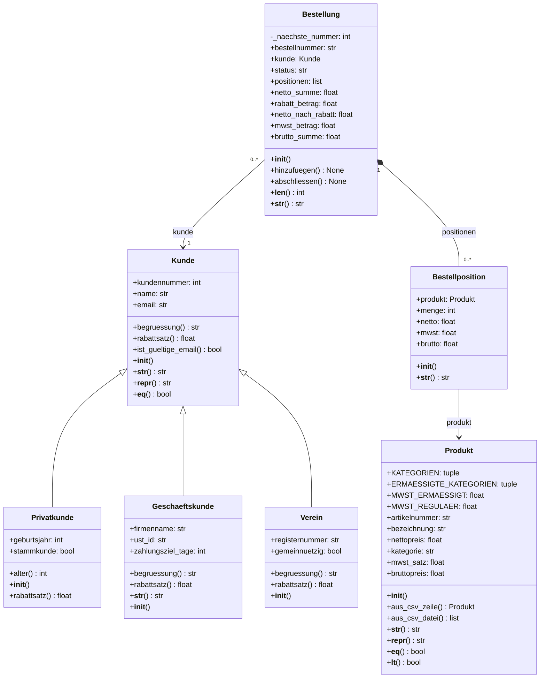

# Projekt-Bestelo
Aufgabe 1: Nazar (NC-UA)

Aufgabe 2: Karen

Aufgabe 3: Elliot

Aufgabe 4: Lucca (Glotz)

Aufgabe 5: Offen

Wir müssen zwischen round und decimal entscheiden, decimal ist laut Foliensatz aber für Phase 2 bestimmt (Für das Runden der Zahlen da wir immer auf die 2 runden sollen).

## UML-Klassendiagramm

